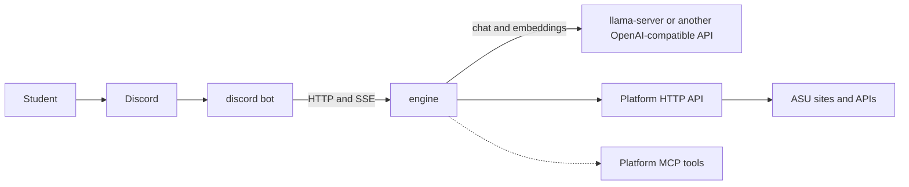

<p align="center">
  
</p>

<h3 align="center">SparkyAI</h3>

<p align="center">
  <a href="docs/ARCHITECTURE.md">Architecture</a> |
  <a href="docs/ROADMAP.md">Roadmap</a> |
  <a href="deploy/README.md">Setup</a>
</p>

SparkyAI is an assistant for Arizona State University students in Discord: a Rust agent engine, a Discord bot, a developer console, and evals. It is an unofficial, open-source student project and is not affiliated with the university.

## Architecture

The engine runs its own agent loop and calls its tools itself. Conversations, memories, the profile graph, confirmations, knowledge search, live ASU queries, Canvas, the Sun Devil Central clubs and events, and account linking come from [Platform](https://github.com/asusoda/platform), a separate service, over its HTTP API and its MCP tools. Platform crawls ASU pages and runs web search. The engine opens no database.



[docs/ARCHITECTURE.md](docs/ARCHITECTURE.md) has the details.

## Run it

Needs [just](https://just.systems), Rust, uv, Docker, a model server, a running Platform with a machine token, and a Discord bot token and guild id in `.env`.

```bash
just bootstrap    # .env from .env.example, git hook, dependencies
# In .env set SPARKY_PLATFORM__URL, SPARKY_PLATFORM__TOKEN and SPARKY_PLATFORM__MCP_URL.
# sparky.toml lists the scopes the token needs.
just model        # llama-server chat and embed on CUDA; just model-cpu without a GPU
just engine
just discord
```

`just up` starts the engine, the bot, and the sandbox runtime in compose. `just` alone lists every recipe, and [deploy/README.md](deploy/README.md) covers deployment.

## What is in the repo

| Path | Holds |
| --- | --- |
| `apps/engine/` | Rust: the agent loop, tools, policy, memory, tracing, and the HTTP API |
| `apps/discord/` | Rust: the Discord bot, an HTTP client of the engine |
| `apps/cli/` | Rust: a terminal console that runs and tails every unit |
| `apps/evals/` | Python: golden cases, scorers, and the baseline gate |
| `apps/web/` | Vite and React: the static site and admin UI |
| `deploy/` | Compose files, Dockerfiles, and model server config |
| `docs/` | `ARCHITECTURE.md` and `ROADMAP.md` |

## Evals

Evals send golden cases from `apps/evals/cases/` to a running engine and score its traces.

```bash
just eval run                  # every suite
just eval run --suite voice    # one suite
just eval baseline             # promote the last report to the baseline
just eval compare              # compare the last report with the baseline
```

The promoted baseline in `apps/evals/baseline.json`:

| Suite | Passed |
| --- | --- |
| tool_selection | 1 of 2 |
| tool_args | 1 of 1 |
| grounding | 2 of 2 |
| memory | 1 of 1 |
| permissions | 0 of 1 |
| clarification | 0 of 1 |
| refusal | 1 of 3 |
| latency | 2 of 2 |

## Data and etiquette

Platform fetches the public ASU pages SparkyAI answers from, and SparkyAI cites the original page. To have a site excluded, open an issue on [Platform](https://github.com/asusoda/platform).

## Docs

- [docs/ARCHITECTURE.md](docs/ARCHITECTURE.md): crate boundaries, traits, Platform stores, and invariants
- [docs/ROADMAP.md](docs/ROADMAP.md): what is built next, and what is out of scope
- [AGENTS.md](AGENTS.md): commands and rules for contributors and coding agents

The 2024 to 2025 prototype is on [`archive/v1`](https://github.com/ashworks1706/SparkyAI/tree/archive/v1), with a write-up in [docs/blog/sparkyai-v1.md](docs/blog/sparkyai-v1.md).

## License

[MIT](LICENSE)
